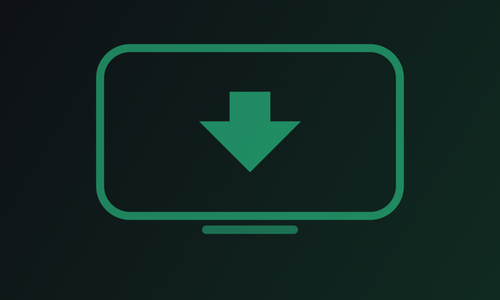
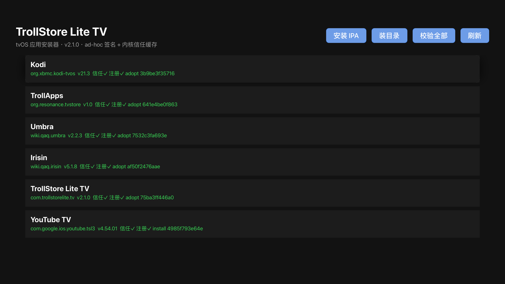
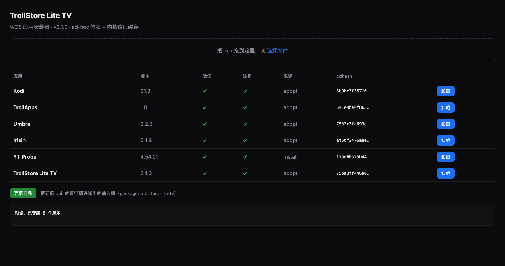

[中文](README.md) · **English**



# TrollStore Lite TV

**Install and run any unencrypted tvOS app on a jailbroken Apple TV** — no Apple developer
certificate required, no CoreTrust exploit required. Think of it as TrollStore Lite for tvOS.

[](https://github.com/comicchang/trollstore-lite-tv/actions/workflows/ci.yml)
[](LICENSE)

> Current version **2.1.6** · Target platform **tvOS 17.x + [Relaxin](docs/en/CREDITS.md) (roothide) jailbreak** · License **MIT**

> ⚠️ **Unofficial project**: not affiliated with opa334's [TrollStore](https://github.com/opa334/TrollStore) /
> TrollStore Lite, and it does not reuse their code. The words "TrollStore Lite" only indicate
> **a tool of the same kind** (installing unsigned apps on a jailbroken device). The underlying
> mechanism is completely different: upstream leans on the CoreTrust vulnerability, this project
> leans on the kernel trust cache. See [Design decisions](docs/en/DESIGN-DECISIONS.md).

---

## What problem does it solve

By default tvOS only runs apps signed by the App Store. If you want to run your own or third-party
tvOS apps on an Apple TV (Kodi, open-source players, an app you compiled yourself), you normally need:

- an Apple developer certificate (free certificates expire after 7 days, need re-signing, and allow
  only a limited number of devices), or
- the **CoreTrust vulnerability** (CVE-2023-41991) that TrollStore relies on — **a dead end on
  tvOS 17.0** (the forged certificate passes, but the kernel's `CS_INVALID_ALLOWED` is never set;
  see [Design decisions](docs/en/DESIGN-DECISIONS.md))

TrollStore Lite TV takes the third path, and the only one that works on a jailbroken device:

```
ldid ad-hoc dual-hash signing  →  write the binary's sha256 cdhash into the kernel trust cache  →  LaunchServices registration
```

Trust is decided by **the cdhash inside the kernel** — independent of the file path, and independent
of whether you hold an Apple certificate. After a reboot the trust cache is rebuilt together with
the jailbreak, so a LaunchDaemon replays the manifest at every jailbreak startup.

---

## Three entry points, one engine

| Entry point | Form | Best for |
|---|---|---|
| **TV UI** `TrollStoreLiteTV.app` | Home-screen app: list / install / install folder / verify / uninstall | Using the remote from the couch |
| **Web store** `http://<device-ip>:8787` | Drag an ipa into the browser to install | Installing things from a computer |
| **CLI** `tsltv` (aliases `trollstore-lite-tv`, `tsl`) | Scripting, batches, troubleshooting | SSH / automation |

All three share the same privileged engine, `tsltvd`. There is no second implementation.





---

## Quick start

Prerequisites: the Apple TV is jailbroken with **Relaxin** (a roothide-family jailbreak) and you can
SSH into it (user `mobile` + sudo).

```sh
# 1) install the tooling (one command, needs the device's sudo password)
git clone https://github.com/comicchang/trollstore-lite-tv.git && cd trollstore-lite-tv
ATV_PASS='<device sudo password>' ./scripts/install.sh 192.168.1.23

# 2) install your first app
ssh mobile@192.168.1.23 'sudo tsltv install /var/tmp/kodi.ipa'

# 3) or open a browser
open http://192.168.1.23:8787     # drag the ipa in
```

Detailed install, verification, uninstall and troubleshooting: [docs/en/INSTALL.md](docs/en/INSTALL.md).

---

## What's in a Release

Every [release](https://github.com/comicchang/trollstore-lite-tv/releases) ships two artifacts:

| File | Purpose |
|---|---|
| `trollstore-lite-tv_<ver>_appletvos-arm64e.deb` | Installer package (`postinst` signs / trusts / registers / starts services automatically) |
| `TSLTVDemo-unsigned.ipa` | An **unsigned** demo app that exercises the whole chain; it is also a template for writing your own tvOS app (source in `examples/hello-tvos`) |

Neither artifact contains any Apple signing material — signing happens on the device, at install time.

## Testing

```sh
./tests/run.sh          # no device needed: 46 assertions (syntax / plist / usage / injection blocking / uninstall origin / precheck / Mach-O / demo ipa & icon / mod inject / machoscan / Stage 1 static gate)
ATV_PASS=... ./scripts/accept.sh <ip>   # needs a device: install / verify / launch / uninstall
```

CI covers shellcheck, the unit tests, local packaging and tag-triggered releases; see [docs/en/TESTING.md](docs/en/TESTING.md).

## Capability boundaries (please read this section first)

| Situation | Result |
|---|---|
| Unencrypted tvOS app (`cryptid 0`) | ✅ Installs and runs |
| Encrypted app downloaded from the App Store (`cryptid 1`) | ❌ **Rejected outright** before install, with an explanation (it would need FairPlay decryption, which this tool does not do) |
| Built against the tvOS 17 SDK or older | ✅ Works |
| Built against the tvOS 18+ SDK (`minOS > 17.0`) | ⚠️ Warned; lowering the version number is worth a try (unverified, see [ROADMAP](docs/en/ROADMAP.md)) |
| iOS app (`platform 2`) | ❌ dyld refuses to load tvOS system libraries (you can change the platform, but missing APIs are on you) |
| After a full device reboot | ⚠️ The jailbreak has to be re-run (Relaxin); once it is back, the daemon tops up trust for your apps automatically |

**Real apps verified to run**: Kodi 21.3 (official tvOS build), tvOS Browser (open-source `WKWebView` browser), TrollAppsTV (third-party IPA from a
GitHub release), the bundled `TSLTVDemo`, and several self-compiled test bundles — all started normally by `launchd`
(PPID=1). See the [App Installation Guide (Demo / Kodi / Browser)](docs/en/APPS.md).

---

## Architecture at a glance

```
   TV UI            web store          CLI
      │                  │                │
      └─ FIFO request ───┴────────────────┘
                         │
                     tsltvd  (root, managed by launchd, serial)
                         │
   ldid · jbctl trustcache · uicache · /Applications
```

The details (why not a socket, why not fork, the state-file format, the security model):
[docs/en/ARCHITECTURE.md](docs/en/ARCHITECTURE.md).

---

## Relationship to TrollStore

**Not a code fork** — this project targets jailbroken tvOS 17.x devices without relying on CoreTrust exploits (stock Xcode `AppleTVOS.sdk` also omits public headers for `posix_spawn` and private container frameworks; see [Gap Analysis & Rehearsal](docs/en/FULL-TROLLSTORE-GAP.md)). What we did:

- **Interface alignment**: `src/fork/tsh` implements TrollStore `RootHelper`'s subcommand
  convention (`install [force] [custom|installd] <ipa>` / `uninstall` / `refresh` / `refresh-all` …)
- **Mechanism replacement**: its CoreTrust criterion is swapped for the kernel trust cache

Licensing and the scope of what we borrowed: [NOTICE](NOTICE). Porting details:
[docs/en/PORTING-TROLLSTORE.md](docs/en/PORTING-TROLLSTORE.md).

---

## Documentation

| Document | Content |
|---|---|
| [docs/en/INSTALL.md](docs/en/INSTALL.md) | Install walkthrough, verification, troubleshooting, uninstall |
| [docs/en/APPS.md](docs/en/APPS.md) | App installation guides (TSLTVDemo / Kodi / tvOS Browser / Userscript host) |
| [docs/en/MODS.md](docs/en/MODS.md) | Native dylib injection & Cobalt userscript path |
| [docs/en/ARCHITECTURE.md](docs/en/ARCHITECTURE.md) | Components, data flow, protocol, security model |
| [docs/en/TESTING.md](docs/en/TESTING.md) | Test matrix, acceptance scripts, historical evidence, untested areas |
| [docs/en/DESIGN-DECISIONS.md](docs/en/DESIGN-DECISIONS.md) | Why it is built this way, and the five routes we disproved |
| [docs/en/PORTING-TROLLSTORE.md](docs/en/PORTING-TROLLSTORE.md) | How to port this mechanism into TrollStore |
| [docs/en/FULL-TROLLSTORE-GAP.md](docs/en/FULL-TROLLSTORE-GAP.md) | Baseline & gap analysis for full persistent (jailed) TrollStore on tvOS 17.0 |
| [docs/en/VERIFICATION-DESIGN.md](docs/en/VERIFICATION-DESIGN.md) | Three-stage minimal verification design (isolation boundaries, dual-backend contract, Go/No-Go gates) |
| [docs/en/ROADMAP.md](docs/en/ROADMAP.md) | Known gaps and what comes next |
| [docs/en/CREDITS.md](docs/en/CREDITS.md) | Dependencies and credits (Relaxin / roothide / Procursus / TrollStore) |
| [CHANGELOG.md](CHANGELOG.md) | Version history |

---

## Security, Legal Notice & Disclaimer

- **Write & safety boundaries**: This tool **writes only to the data partition and jbroot**; it does not touch the read-only system volume, jailbreak basebin, or kernel. Uninstall is protected by an `origin=install` manifest guard so system and adopted apps cannot be accidentally deleted.
- **Copyright & zero third-party assets**: Released under the **MIT License** ([LICENSE](LICENSE)). This repository contains original source code only — **no** third-party `.ipa` files, firmware, icons, certificates, or FairPlay keys. It provides **no** DRM/FairPlay decryption and rejects encrypted App Store bundles (`cryptid != 0`) before installation.
- **Trademarks & non-affiliation**: Apple, Apple TV, tvOS, App Store, and FairPlay are trademarks of Apple Inc.; TrollStore is by opa334; Kodi is a trademark of the XBMC Foundation. This project is independent and not affiliated with or endorsed by any of them. See [NOTICE](NOTICE).
- **Disclaimer of warranty & liability (AS-IS)**: Provided "AS IS" without warranty of any kind. Use only on your own devices with software you have the legal right to install, in compliance with applicable laws. Back up before starting; the authors and contributors assume no liability for device damage, data loss, or misuse.

How to report security issues: [SECURITY.md](SECURITY.md).
