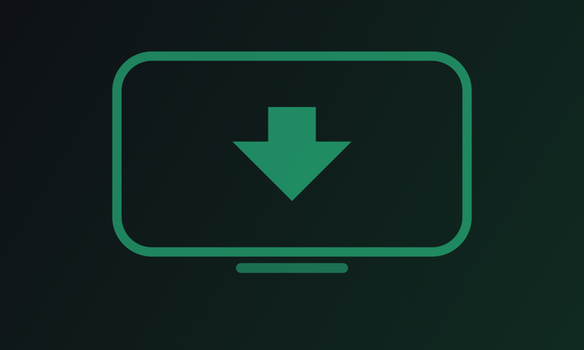
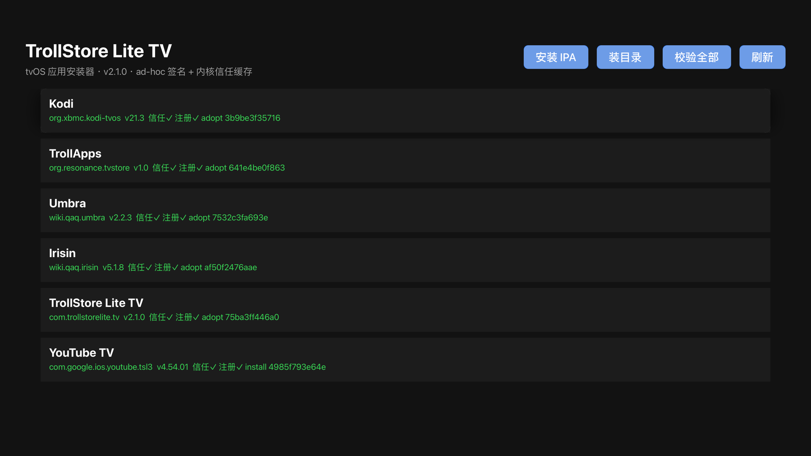
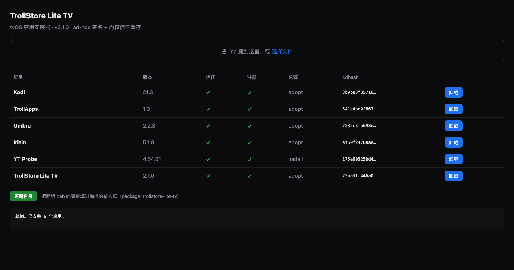

# TrollStore Lite TV

[English](README.en.md) · **中文**

**在已越狱的 Apple TV 上安装并运行任意未加密的 tvOS 应用** —— 不需要 Apple 开发者证书，
不需要 CoreTrust 漏洞利用。可以理解为 tvOS 版的 TrollStore Lite。

[](https://github.com/comicchang/trollstore-lite-tv/actions/workflows/ci.yml)
[](LICENSE)

> 当前版本 **2.1.6** · 目标平台 **tvOS 17.x + [Relaxin](docs/zh/CREDITS.md)（roothide）越狱** · 许可证 **MIT**

> ⚠️ **非官方项目**：与 opa334 的 [TrollStore](https://github.com/opa334/TrollStore) /
> TrollStore Lite **没有隶属关系**，也未复用其代码。名字里的 "TrollStore Lite" 仅表示
> **同类工具**（在越狱设备上安装未签名应用）；底层机制完全不同——上游靠 CoreTrust 漏洞，
> 本项目靠内核信任缓存，详见 [设计取舍](docs/zh/DESIGN-DECISIONS.md)。

---

## 它解决什么问题

tvOS 默认只允许运行 App Store 签名的应用。想在 Apple TV 上跑自己的或第三方的 tvOS 应用
（Kodi、各种开源播放器、自己编译的 app），通常需要：

- 一个 Apple 开发者证书（免费证书 7 天过期、需要重签、设备数量受限），或
- 原版 TrollStore 所用的 **CoreTrust 漏洞**路线（CVE-2023-41991，仅限 tvOS ≤ 17.0 且本项目不实现漏洞利用；早期复核与 Gap 分析见 [Gap 分析](docs/zh/FULL-TROLLSTORE-GAP.md)）

TrollStore Lite TV 走的是第三条路，也是**越狱设备上唯一可行的那条**：

```
ldid ad-hoc 双哈希签名  →  把该二进制的 sha256 cdhash 写进内核信任缓存  →  LaunchServices 注册
```

信任的判据是**内核里的 cdhash**，与文件路径无关，与你有没有 Apple 证书也无关。
重启后信任缓存会随越狱重来，因此有一个 LaunchDaemon 在每次越狱启动时按清单重放。

---

## 三个入口，同一个引擎

| 入口 | 形态 | 适合 |
|---|---|---|
| **电视界面** `TrollStoreLiteTV.app` | 主屏应用：列表 / 安装 / 装目录 / 校验 / 卸载 | 在沙发上用遥控器操作 |
| **网页商店** `http://<device-ip>:8787` | 浏览器里拖 ipa 进去就装 | 从电脑上装东西 |
| **命令行** `tsltv`（别名 `trollstore-lite-tv`、`tsl`） | 脚本化、批量、排障 | SSH / 自动化 |

三者共用同一个特权引擎 `tsltvd`，没有第二套逻辑。





---

## 快速开始

前置：Apple TV 已用 **Relaxin**（roothide 系越狱）越狱，并且能 SSH 登录（`mobile` 用户 + sudo）。

```sh
# 1) 装上工具（一条命令，需要设备 sudo 密码）
git clone https://github.com/comicchang/trollstore-lite-tv.git && cd trollstore-lite-tv
ATV_PASS='<设备sudo密码>' ./scripts/install.sh 192.168.1.23

# 2) 装你的第一个 app
ssh mobile@192.168.1.23 'sudo tsltv install /var/tmp/kodi.ipa'

# 3) 或者打开浏览器
open http://192.168.1.23:8787     # 把 ipa 拖进去
```

详细的安装、验证、卸载与排障：[docs/INSTALL.md](docs/zh/INSTALL.md)。

---

## Release 里有什么

每个 [Release](https://github.com/comicchang/trollstore-lite-tv/releases) 提供两个产物：

| 文件 | 用途 |
|---|---|
| `trollstore-lite-tv_<ver>_appletvos-arm64e.deb` | 安装包（`postinst` 自动签名/信任/注册/起服务） |
| `TSLTVDemo-unsigned.ipa` | **无签名** demo 应用，用来验证链路；也是写自己 tvOS app 的模板（源码在 `examples/hello-tvos`） |

两者都不含任何 Apple 签名材料 —— 签名在设备上安装时现场完成。

## 测试

```sh
./tests/run.sh          # 不需要设备：46 条断言（语法/plist/用法/注入拦截/卸载护栏/预检判定/Mach-O 解析/demo ipa 与图标/mod 注入/machoscan/Stage 1 静态闸门）
ATV_PASS=... ./scripts/accept.sh <ip>   # 需要设备：装/验/启/卸闭环
```

CI 覆盖 shellcheck、单元测试、本地打包与 tag 触发的 Release，见 [docs/TESTING.md](docs/zh/TESTING.md)。

## 能力边界（请先读这一节）

| 情况 | 结果 |
|---|---|
| 未加密的 tvOS 应用（`cryptid 0`） | ✅ 正常安装并运行 |
| App Store 下载的加密应用（`cryptid 1`） | ❌ 装前**直接拒绝**并说明原因（需 FairPlay 解密，本工具不做） |
| 用 tvOS 17 及更低版本 SDK 构建 | ✅ 正常 |
| 用 tvOS 18+ SDK 构建（`minOS > 17.0`） | ⚠️ 会警告；可尝试改小版本号（未验证，见 [ROADMAP](docs/zh/ROADMAP.md)） |
| iOS 应用（`platform 2`） | ❌ dyld 拒绝加载 tvOS 系统库（可改 platform，但 API 缺失自负） |
| 整机重启后 | ⚠️ 需要重新运行越狱（Relaxin）；重新越狱后应用由守护进程自动补信任 |

**已验证可以跑起来的真实应用**：Kodi 21.3（官方 tvOS 构建）、tvOS Browser（`WKWebView` 开源浏览器）、TrollAppsTV（GitHub 发布的第三方 IPA）、
自带 `TSLTVDemo` 及多款自编译测试包 —— 全部由 `launchd` 正常启动（PPID=1），详见 [应用安装指南（Demo / Kodi / 浏览器）](docs/zh/APPS.md)。

---

## 架构一览

```
   电视界面            网页商店            CLI
      │                  │                │
      └──── FIFO 请求 ────┴────────────────┘
                     │
              tsltvd  （root，launchd 托管，串行处理）
                     │
      ldid · jbctl trustcache · uicache · /Applications
```

细节（为什么不能用 socket、为什么不能 fork、状态文件格式、安全模型）：
[docs/ARCHITECTURE.md](docs/zh/ARCHITECTURE.md)。

---

## 与 TrollStore 的关系

**不是代码 fork** —— 本项目面向已越狱的 tvOS 17.x 设备，不依赖 CoreTrust 漏洞利用（公开 Xcode `AppleTVOS.sdk` 亦未暴露 `posix_spawn` 与私有容器头文件，详见 [Gap 分析与预演实测](docs/zh/FULL-TROLLSTORE-GAP.md)）。我们做的是：

- **接口对齐**：`src/fork/tsh` 实现了 TrollStore `RootHelper` 的子命令约定
  （`install [force] [custom|installd] <ipa>` / `uninstall` / `refresh` / `refresh-all` …）
- **机制替换**：把它的 CoreTrust 判据换成内核信任缓存

许可与借鉴范围见 [NOTICE](NOTICE)，移植细节见 [docs/PORTING-TROLLSTORE.md](docs/zh/PORTING-TROLLSTORE.md)。

---

## 文档

| 文档 | 内容 |
|---|---|
| [docs/INSTALL.md](docs/zh/INSTALL.md) | 安装教程、验证、排障、卸载 |
| [docs/APPS.md](docs/zh/APPS.md) | 常用应用安装指南（TSLTVDemo / Kodi / tvOS 浏览器 / 油猴脚本托管） |
| [docs/MODS.md](docs/zh/MODS.md) | 原生 dylib 注入与 Cobalt 脚本注入路径 |
| [docs/ARCHITECTURE.md](docs/zh/ARCHITECTURE.md) | 组件、数据流、协议、安全模型 |
| [docs/TESTING.md](docs/zh/TESTING.md) | 测试矩阵、验收脚本、历史证据、未测项 |
| [docs/DESIGN-DECISIONS.md](docs/zh/DESIGN-DECISIONS.md) | 为什么这样做，以及五条被证伪的路线 |
| [docs/PORTING-TROLLSTORE.md](docs/zh/PORTING-TROLLSTORE.md) | 如何把本机制移植进 TrollStore |
| [docs/FULL-TROLLSTORE-GAP.md](docs/zh/FULL-TROLLSTORE-GAP.md) | 现状总结与原版免越狱 TrollStore（CoreTrust 2）Gap 分析与三道验证闸门 |
| [docs/VERIFICATION-DESIGN.md](docs/zh/VERIFICATION-DESIGN.md) | 三级最小验证系统设计（隔离边界、双后端契约、Go/No-Go 闸门） |
| [docs/ROADMAP.md](docs/zh/ROADMAP.md) | 已知缺口与后续计划 |
| [docs/CREDITS.md](docs/zh/CREDITS.md) | 依赖与致谢（Relaxin / roothide / Procursus / TrollStore） |
| [CHANGELOG.md](CHANGELOG.md) | 版本记录 |

---

## 安全、合规与免责声明

- **安全边界**：本工具**只写数据分区与 jbroot**，不碰只读系统卷、不修改越狱本体（basebin）、不动内核；卸载受清单来源护栏保护（仅允许卸载 `origin=install` 的应用），不会误删系统应用。
- **版权与无侵权内容**：本仓库采用 **MIT 许可证**（见 [LICENSE](LICENSE)），仅包含原创源码，**不包含任何**第三方版权二进制、`.ipa`、固件、图标或解密密钥；不提供 FairPlay 解密或任何绕过 App Store 付费的能力（`cryptid≠0` 的加密包会被直接拒绝）。
- **商标与非官方声明**：Apple、Apple TV、tvOS、App Store、FairPlay 为 Apple Inc. 商标；TrollStore 归属 opa334；Kodi 归属 XBMC Foundation。本项目与上述任何主体均无隶属或背书关系，详见 [NOTICE](NOTICE)。
- **责任豁免（AS-IS）**：软件按"现状"提供，不附带任何明示或默示担保。请仅在本人拥有所有权的设备上安装你有合法使用权的软件并遵守当地法律法规；操作前请自行备份，作者与贡献者不对任何设备损坏、数据丢失或使用后果承担责任。

安全问题的报告方式见 [SECURITY.md](SECURITY.md)。
