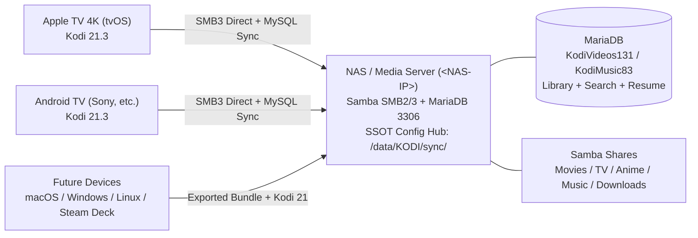

# Multi-Device Kodi 21 Configuration & Library Sync Guide

> [中文](../zh/KODI-SYNC.md) ｜ Back to [Recommended Apps & Setup](APPS.md)

This guide documents a unified **Kodi 21 (Omega)** multi-device setup (Apple TV tvOS, Android TV, macOS, Windows, Linux, Steam Deck, etc.) using direct **SMB2/3** media shares and a shared **MariaDB** database, with a reusable onboarding workflow for future devices.

---

## 1. Why Direct SMB + Shared MariaDB Instead of Plex Relay

| Dimension | Kodi via Plex Addons (`script.plex` / PM4K / PKC) | Direct SMB + Shared MariaDB (Recommended) |
|---|---|---|
| **Playback & Disc Support** | Plex cannot direct-play BDMV Blu-ray folder structures; complex ASS anime subtitles often trigger server transcoding | Native hardware decoding via Apple VideoToolbox / Android MediaCodec for 4K HDR/DoVi, BDMV folders, and ASS subtitles |
| **Local NFO / Artwork** | Relies on Plex's separate scraper, disconnected from tinyMediaManager local NFOs | Kodi reads local `.nfo` and local artwork first, falling back to TMDB only when missing |
| **Multi-Device Sync & Search** | Requires per-device Plex auth/tokens; PKC overwrites local Kodi DBs | All Kodi 21 clients share one MariaDB (`KodiVideos131` / `KodiMusic83`) for library, global search, watched state, and resume points |
| **Maintenance** | Official `script.plex 0.3.5` is discontinued; third-party addons lag major Kodi releases | 100% native Kodi protocols and XMLs, zero third-party bridge plugins |

---

## 2. Multi-Device Sync Architecture

### Sync Boundary: Shared vs. Device-Local

| Item | Shared Across Devices? | Rationale |
|---|---|---|
| `sources.xml` / `mediasources.xml` | ✅ Shared (byte-identical) | Ensures every client records identical `smb://<NAS-IP>/<Share>/` paths in MariaDB, preventing duplicate library entries |
| `passwords.xml` | ✅ Shared (rendered from local secrets) | Keeps SMB credentials out of `sources.xml` and the MariaDB `path` table |
| `advancedsettings.xml` | ✅ Shared (byte-identical) | Points all clients to the shared MariaDB, enables watched/resume import, and enforces scan-exclusion regexes |
| MariaDB `KodiVideos131` / `KodiMusic83` | ✅ Live-shared | Instant cross-device library, search index, watched flags, and resume timestamps |
| `Thumbnails/` & `Textures13.db` | ❌ **Local per device** | Sharing `Thumbnails/` over network `pathsubstitution` causes DB lock contention and UI stutter; keep local caches |
| `guisettings.xml` | ⚠️ Patch selected keys only | Preserve per-device video/audio/display output settings; unify only SMB protocol bounds, filecache, locale, and Web JSON-RPC |

---

## 3. Core Configuration Standards (Templates)

> Keep real credentials in a `chmod 600` `secrets.env` file on the NAS only — **never commit credentials or private LAN IPs to public Git repositories**.

- **`sources.xml`**: Use canonical `smb://<NAS-IP>/<Share>/` paths (no embedded credentials, trailing `/` preserved) for `Movie`, `TV`, `Amine`, `Downloads` (`<video>`), and `Music` (`<music>`).
- **`passwords.xml`**: Map server prefix `smb://<NAS-IP>/` → `smb://<SMB-USER>:<URL-ENCODED-SMB-PASS>@<NAS-IP>/`.
- **`advancedsettings.xml`**:
  - Use valid XML comments (`<!-- ... -->`) only — never `//`;
  - Do not use deprecated Kodi 20 `<cache>` blocks (use `filecache.*` in `guisettings.xml` on Kodi 21);
  - Set `<cleanonupdate>false</cleanonupdate>` to prevent accidental library wipes if the NAS is offline;
  - Use `<excludefromscan action="append">` and `<excludetvshowsfromscan action="append">` to preserve Kodi's built-in `trailer`/`sample` patterns while excluding `Downloads/`, `SPs/`, `PV/`, `Extra/`, `Bonus/`, `Menu/`, `CD/`, etc. Add `<audio><excludefromscan action="append"><regexp>Music\/</regexp></excludefromscan></audio>` if `Music/` is browse-only.
- **`guisettings.xml` unified keys**:
  - `smb.minprotocol=2`, `smb.maxprotocol=3`, `smb.chunksize=128`
  - `filecache.buffermode=1`, `filecache.memorysize=64`, `filecache.readfactor=400`
  - `videolibrary.updateonstartup=true`
  - `musiclibrary.updateonstartup=false`, `musiclibrary.backgroundupdate=false`, `musiclibrary.downloadinfo=false` (keep music browse-only)
  - `services.webserver=true` (port `8080`) and `services.esallinterfaces=true` (port `9090`, for LAN JSON-RPC and Home Assistant integration)

---

## 4. Platform `userdata/` Paths & Future Device Onboarding

> **Version requirement**: All devices sharing the same MariaDB database must run the **same major Kodi release** (e.g., **Kodi 21.x Omega**, schema `Videos131` / `Music83`).

| Platform / Device | Kodi `userdata/` Path | Sync Method |
|---|---|---|
| **Apple TV 4K (tvOS + Relaxin/roothide)** | `/var/mobile/Library/Caches/Kodi/userdata/` | SSH/SCP 4 XMLs + `patch-gui` (terminate stale background Kodi first so it does not overwrite `guisettings.xml` on exit) |
| **Android TV (Sony / Shield, etc.)** | `/sdcard/Android/data/org.xbmc.kodi/files/.kodi/userdata/` | Passive LAN ADB push (zero TV wake, zero HDMI switch) |
| **macOS (Reserved)** | `~/Library/Application Support/Kodi/userdata/` | Copy exported 4 XMLs + `patch-gui` |
| **Windows (Reserved)** | `%APPDATA%\Kodi\userdata\` | Copy exported 4 XMLs + `patch-gui` |
| **Linux / Steam Deck (Reserved)** | `~/.kodi/userdata/` (Flatpak: `~/.var/app/tv.kodi.Kodi/data/userdata/`) | Copy exported 4 XMLs + `patch-gui` |
| **iPadOS / iOS (Reserved)** | `<App-Container>/Library/Preferences/Kodi/userdata/` | Import exported 4 XMLs |

### 4-Step Onboarding for Any New Device
1. Install matching **Kodi 21.x (Omega)**, launch once to initialize default `userdata/`, then exit completely;
2. On the NAS, run `python3 /data/KODI/sync/sync_kodi.py render --out <export-dir>` to generate the 4 validated XMLs;
3. Copy `sources.xml`, `mediasources.xml`, `passwords.xml`, and `advancedsettings.xml` into the new device's `userdata/` and run `patch-gui` on its `guisettings.xml`;
4. Launch Kodi — the full shared library, search index, watched flags, and resume points appear immediately with zero re-scraping.

---

## 5. First-Scan & Search Verification Checklist

1. **SMB & MariaDB readiness**: Confirm `smbclient //<NAS-IP>/<Share> -m SMB3` lists files and MariaDB `KodiVideos131.path` has pre-seeded content/scraper rows (`Movie`, `TV`, `Amine`), with browse-only folders (e.g., `Downloads/`) explicitly marked `noUpdate=1, exclude=1`;
   > **Kodi 21 (`Videos131`) Schema Gotcha**: If cloning an empty database with `mysqldump --no-data` instead of letting Kodi bootstrap it, you MUST seed both `version` (`idVersion=131`) and **`videoversiontype`** (387 built-in rows); otherwise `movie_view`'s `INNER JOIN videoversiontype` returns 0 rows, making scraped movies invisible in Kodi UI and JSON-RPC.
2. **Initial library scan**: Open Kodi 21 on any synced device (auto-updates on startup or via JSON-RPC `VideoLibrary.Scan`);
3. **Search & cross-device sync verification**:
   - Search by title in Movies / TV Shows on Device A and start playback;
   - Stop after 2 minutes, open Kodi on Device B, and confirm identical search results and resume point appear immediately.
