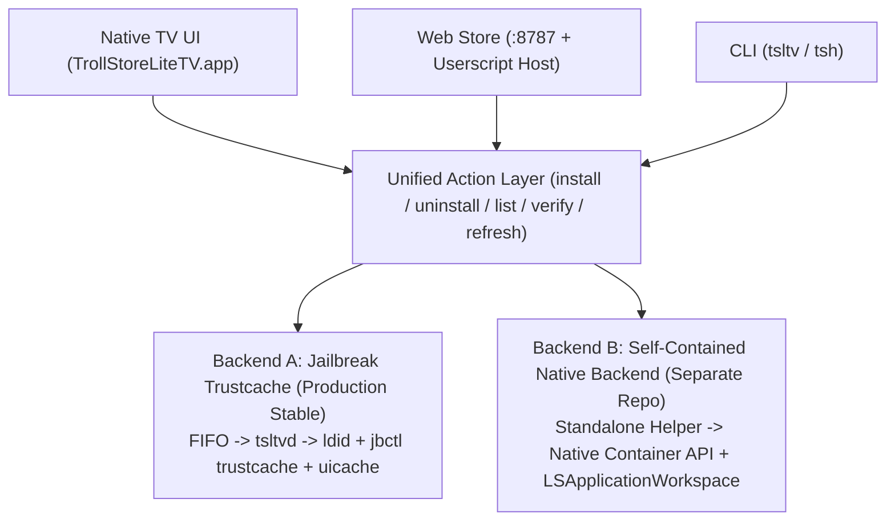
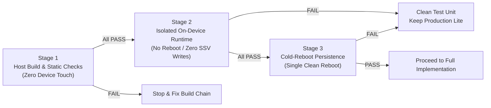

[中文](../zh/VERIFICATION-DESIGN.md) · [English](VERIFICATION-DESIGN.md)

# Three-Stage Minimal Verification System Design (Architecture and Risk-Control Specification)

> Applies to: TrollStore Lite TV (`tvOS 17.x`) architecture-evolution research  
> Document nature: **system verification framework, isolation boundaries, and dual-backend architecture design** (pure architecture and acceptance methodology; contains no exploit code or concrete attack instructions)

---

## 1. Design Goals and Core Principles

When evaluating new app signing/registration backends on a non-downgradable Apple TV 4K with no USB recovery port (`AppleTV14,1`, tvOS 17.0 `21J354`), the first goal is not "get it working as fast as possible" but **ensuring every failure can be rolled back 100% losslessly, never touching the existing stable environment**.

This design follows four hard principles:

1. **Blast-Radius Isolation**: test subjects must use a fully independent test identity (e.g. `com.tsltv.verify.poc`) and an independent directory, physically isolated from production apps (`TrollStoreLiteTV`, `Kodi`, `YouTubeTVL`, `Browser`, `RelaxinTV`).
2. **Zero System Mutation**: never modify the `/rootfs` read-only volume, never replace or piggyback on a built-in system app, never touch the jailbreak basebin or system-level LaunchDaemons.
3. **Falsification First**: before committing to full engineering work, use minimal test units to verify whether the core hypothesis holds; once falsified, stop the loss immediately to avoid sunk cost.
4. **Evidence-Based Gating**: each verification level must be judged pass/fail by objectively observable signals (process exit code, system state queries, process list, screen captures); subjective inference is forbidden as a basis for advancing to the next level.

---

## 2. System Layering and Dual-Backend Abstraction

To avoid rewriting the front end each time a different underlying mechanism is verified, the system is split into a **stable presentation and control layer** and **pluggable execution backends**:



### Interface Contract (backend-agnostic)

Whichever backend is used, only the same set of idempotent, guard-railed operation semantics is exposed externally:

| Operation | Input | Success criteria | Safety rails |
|---|---|---|---|
| `preflight(ipa)` | local `.ipa` | parse `platform` / `minOS` / `cryptid` | `cryptid != 0` is rejected outright |
| `install(ipa)` | unencrypted `.ipa` | deploy container + sign/trust + register + record | write only the independent app directory and record file |
| `verify(bid)` | `bundle_id` | signing state, registration type, and main-binary consistency all normal | read-only check, no side effects |
| `uninstall(bid)` | `bundle_id` | unregister + delete directory + clear record | only entries with `origin=install` may be deleted |

---

## 3. Security Boundaries and Rollback Design

Before entering the three-stage verification, fixed isolation rails and rollback contracts are defined:

| Rail | Constraint | Rollback action |
|---|---|---|
| **Namespace isolation** | only dedicated test bundle IDs (`com.tsltv.verify.*`) and dedicated temporary directories are allowed | delete the corresponding independent container and temp directory, unregister that test bundle ID |
| **Trust-cache purity** | when evaluating non-jailbroken compatibility, test units **must not** write to the jailbreak kernel trust cache, to prevent false positives | verify the trust-cache entry count is identical before and after the test |
| **Zero production impact** | do not overwrite existing apps in `/Applications`, do not modify the 7 existing production records in `installed.tsv` | compare `tsltv verify` before and after to confirm all 7/7 still `PASS` |
| **Zero system-volume writes** | skip the Persistence Helper system-app replacement phase, do not touch `/rootfs/Applications/` | no system-level recovery needed |

---

## 4. Three-Stage Minimal Verification System

The three stages proceed in order of **risk from zero upward and cost from small upward**; on failure, clean up and diagnose the root cause before iterating (no artificial retry cap; the only hard boundaries are device safety and no unapproved reboots).



### Stage 1: Host-Side Build and Static Metadata Verification (zero device risk)

- **Goal**: confirm that, without touching the Apple TV at all, the build toolchain, minimal test payloads, and static structure all conform to the tvOS 17.0 target specification.
- **Subjects**:
  1. a minimal command-line test unit (prints only the process `uid`/`pid` and exits `0` normally, writes no files);
  2. a minimal UIKit test app (a single page showing a solid-color background and a text identifier, to verify FrontBoard renders it normally).
- **Static check list**:
  - Architecture and platform: `arm64`, `platform = 3 (tvOS)`, `minOS <= 17.0`, `cryptid = 0`;
  - Bundle structure: `Info.plist` `CFBundleIdentifier` (`com.tsltv.verify.*`), `CFBundleExecutable`, and `CFBundlePrimaryIcon` complete and consistent;
  - Entitlement declarations: confirm the test unit contains only the minimal required entitlement set and no out-of-bounds path write entitlements.
- **Pass criteria**: all static metadata checks pass and local automated tests report 0 failures.

### Stage 2: On-Device Isolated Runtime Verification (no reboot, no system-app changes)

- **Goal**: without rebooting the device or modifying any existing app or system file, verify the minimal test unit's loading, container deployment, registration type, and process-launch chain in the target runtime environment.
- **Sub-item acceptance matrix**:

| Sub-item | What is verified | Expected observable evidence | Failure determination |
|---|---|---|---|
| **2A. Independent run check** | test unit starts without writing to the jailbreak trust cache | executes normally and returns exit code `0` | killed by the kernel (e.g. `SIGKILL` / `Killed: 9`) |
| **2B. Native container and registration** | deploy an independent container and register as type `System` using the tvOS runtime container and LaunchServices API | query returns registered with `Type = System`, path inside the independent test container | registration errors or falls back to a non-launchable state |
| **2C. UI launch and screen confirmation** | ask the system to launch the test app and capture live frames | process stays resident and stable, no crash dump, test identifier text visible in the screenshot | immediate exit, black screen, or `.ips`/`.dmp` crash logs produced |
| **2D. Production baseline regression** | re-verify the existing environment during and after the test | `tsltv verify` 7/7 `PASS`, Kodi / YouTube TVL / Browser unaffected | any existing app's state regresses |

- **Cleanup**: after data collection, if Stage 3 is not planned, immediately unregister and delete the test unit, and confirm device state has returned 100% to baseline.

### Stage 3: Cold-Reboot Persistence Verification (final Go / No-Go gate)

- **Goal**: verify the test app's persistence launchability and boundary behavior under a real power-off/reboot while the **jailbreak environment has not yet been re-activated**.
- **Procedure**:
  1. confirm the Stage 2 test app is normally launchable and record a state snapshot;
  2. perform one normal Apple TV reboot;
  3. **do not activate the jailbreak first**: launch the test app directly from the Home screen and observe whether it reaches its UI normally;
  4. **boundary check**: record how the installed test app behaves in that state (explicitly note whether it depends on the system icon cache not being rebuilt);
  5. **restore baseline**: re-activate the daily jailbreak environment, re-verify that all 7 original apps and the `:8787` service are normal, then remove the test app.

---

## 5. Decision Matrix (Go / No-Go Criteria)

| Result combination | Conclusion | Subsequent engineering strategy |
|---|---|---|
| Stage 1 + 2 + 3 **all PASS** | **GO** | start the dual-backend abstraction work: keep the existing TV UI, the `:8787` web store, and userscript hosting, add the self-contained native backend alongside the jailbreak backend |
| Stage 1 PASS, Stage 2A/3 **FAIL** | **NO-GO (architecture stop-loss)** | proves the current firmware is infeasible on this path; terminate the original-port direction immediately and keep investing in `TrollStore Lite TV` (the jailbroken full `retrust` already covers reboot recovery) |
| Stage 2A PASS, but 2B/2C **FAIL** | **CONDITIONAL (engineering adaptation only)** | the underlying mechanism works but container/registration/entitlement parameters are off; fix registration and entitlements configuration only inside the isolated test unit, retest Stage 2, and do not enter Stage 3 |

---

## 6. State Tracking and Record-Keeping Rules

After each verification level, record the following evidence fields using a unified template (writing only "pass/fail" is forbidden):

- **Environment baseline**: device model, exact OS version and build number (e.g. `AppleTV14,1` / `tvOS 17.0 21J354`);
- **Test subject summary**: bundle ID, binary hash, arch/platform/encryption flags;
- **Observable output**: exit code, registration-type query result, process liveness and resource usage, crash-log delta (should be 0);
- **Baseline re-check result**: verification result of existing production apps after cleaning up the test subject (7/7 `PASS`).

---

## 7. Open-Source Project Adoption Strategy (Repository, License Assessment, Cross-Referencing, and Local Build)

### 7.1 Repository and Evolution Strategy

- **Keep `trollstore-lite-tv` unchanged as the stable mainline**: keep serving every jailbroken tvOS 17.x device, staying lightweight, free of complex C-library dependencies, with the existing `.deb` upgrade path stable.
- **Evolve the new mechanism in a separate repository**: develop the new architecture (self-contained native backend + three-stage verification implementation) in its own repository; the front end reuses `TrollStore Lite TV`'s TV UI and `:8787` web store, connecting to the backend through the unified action protocol defined in §2.
- **Naming and attribution principles**:
  - documents mention `Apple TV` (product name) and `tvOS` (OS name) only indicatively, to describe the runtime platform;
  - for open-source projects such as `TrollStore`, focus on **proper cross-referencing, repository links, copyright retention, and Credit acknowledgement**, and never claim an affiliation with the upstream official project without authorization.

### 7.2 License Audit and Licensing Plan Assessment (measured upstream LICENSE)

The real `LICENSE` files of all relevant upstream and external open-source projects have been checked directly:

| Project / library | Measured license | Copyright holder | Relationship to this project | MIT compatibility |
|---|---|---|---|---|
| [`opa334/TrollStore`](https://github.com/opa334/TrollStore) | main body **MIT**; only `RootHelper/uicache.m` is **BSD-4-Clause** (DEP-5 format) | Lars Fröder (`uicache.m` includes CoolStar / Procursus) | architecture reference / potential code reuse | ✅ main body compatible with MIT; reusing `uicache.m` requires keeping the CoolStar BSD-4-Clause notice in `NOTICE` |
| [`straight-tamago/TrollStore-tvOS`](https://github.com/straight-tamago/TrollStore-tvOS) | **MIT** + upstream DEP-5 retained (MIT + `uicache.m` BSD-4-Clause) | straight-tamago / Lars Fröder | tvOS adaptation reference | ✅ same as above |
| [`opa334/ChOma`](https://github.com/opa334/ChOma) | pure **MIT** | Lars Fröder | Mach-O handling library reference | ✅ 100% MIT-compatible |
| [`owngoal-dev/Relaxin`](https://github.com/owngoal-dev/Relaxin) | pure **MIT** | `@Lakr233` | runtime environment prerequisite / documentation reference | ✅ 100% MIT-compatible |
| [`Lakr233/vphone-cli`](https://github.com/Lakr233/vphone-cli) | pure **MIT** | Lakr233 | optional virtual debugging reference / documentation reference (**current latest-version limit**: tvOS presets only support recent builds around tvOS 26.6–27.x / ~tvOS 27 and cannot run tvOS 17.x) | ✅ 100% MIT-compatible |
| [`majd/ipatool`](https://github.com/majd/ipatool) | pure **MIT** | Majd Alfhaily | external tool documentation reference | ✅ 100% MIT-compatible |
| [`reisxd/TizenTubeCobalt`](https://github.com/reisxd/TizenTubeCobalt) | **BSD-3-Clause** | Reis Can | external script ecosystem reference | ✅ 100% MIT-compatible |
| [`EthanArbuckle/fairplay-decrypt`](https://github.com/EthanArbuckle/fairplay-decrypt) | **GPL-3.0** | Ethan Arbuckle | **external documentation reference only, zero source import** | ⚠️ importing the source would trigger GPL contagion and conflict with BSD-4-Clause; keeping it as an external reference means zero conflict |
| [`libarchive`](https://github.com/libarchive/libarchive) / [`OpenSSL 3`](https://github.com/openssl/openssl) | **BSD-2-Clause** / **Apache-2.0** | their respective communities | optional link libraries for the native backend | ✅ both MIT-compatible (retain the corresponding NOTICE) |

**Licensing strategy conclusions**:
1. **Keep the main license as standard plain MIT (consistent with the TrollStore upstream main body)**:
   - the root `LICENSE` stays a standard plain **MIT License** (do not copy DEP-5 mixed text straight into `LICENSE`, otherwise GitHub recognizes it as `NOASSERTION` and the `MIT` badge is lost).
   - all upstream and third-party attribution goes into the root `NOTICE` and `CREDITS.md`, item by item with the original repository link, copyright holder, and license name.
2. **Two hard compatibility boundaries**:
   - **do not reuse `RootHelper/uicache.m` (prefer writing our own native `LSApplicationWorkspace` code)**: the whole repository can then stay 100% plain MIT; if `uicache.m` must really be reused, the complete CoolStar / Procursus / Lars Fröder BSD-4-Clause notice must be retained in both `NOTICE` and the file header.
   - **`fairplay-decrypt` (GPL-3.0) stays strictly an external documentation reference**: never copy or statically bundle it into the repository, to avoid license contagion and BSD-4-Clause conflict.

### 7.3 Build and Verification Strategy (local-first, no remote CI)

- **Remote CI is not required**: tvOS cross-compilation depends on the local Xcode SDK / private framework headers and an on-device verification environment; public GitHub Actions runners are expensive to maintain and cannot cover on-device behavior.
- **Adopt a "local one-shot self-check + local macOS build and packaging" model**:
  - the repository provides a local verification script (e.g. `./scripts/check.sh`): shell/code syntax checks, unit tests for core pure logic, plist/JSON validation, and checks against accidentally committing sensitive files (`.ipa` / `.bin` / `.p12` / credentials);
  - before each release, complete compilation, local verification, and on-device acceptance on the local macOS, then upload the artifacts directly via `gh release create`.

### 7.4 Implementation Layering Checklist

| Module | Implementation source | Notes |
|---|---|---|
| **Front-end shell (TV UI + `:8787` web store + userscript hosting)** | reuse the existing `trollstore-lite-tv` implementation directly | keep the 39 ms async cache, the XHR upload progress bar, and `/api/userscripts.js` hosting |
| **Unified action protocol layer** | new lightweight adapter layer | exposes `preflight / install / uninstall / list / verify / refresh` upward, routes downward to the jailbreak backend or the self-contained native backend by configuration |
| **Version preflight and guard rails (Preflight)** | reuse and extend `macho_info` / `precheck_verdict` | validate device model, tvOS build, binary architecture, and `cryptid == 0` at startup and before install; exit explicitly when unmet |
| **Documentation and attribution system** | standard template | required: `LICENSE` (plain MIT), `NOTICE` (complete upstream and external tool Credit list), `README.md` / `README.zh.md`, `SECURITY.md`, `.gitignore` |

---

## 8. Stage 1 Engineering Implementation (2026-11-25)

Stage 1 is implemented as a repeatable host-side gate [`tests/stage1/run.sh`](../../tests/stage1/run.sh): using the local `AppleTVOS.sdk`, it builds both minimal test units, the CLI and the UIKit one, and validates architecture, platform, `minos`, `cryptid`, bundle structure, and signing state, emitting the §6 evidence fields. It never touches the Apple TV.

```sh
./tests/stage1/run.sh        # 0 = all PASS; 2 = no tvOS SDK on this host (skip)
```

`tests/run.sh` runs this gate automatically on macOS hosts with the SDK; Linux CI skips it.

---

## 9. Stage 2 Isolated Runtime Results (2026-11-25)

> **Verdict: `CONDITIONAL / suspended`.** 2B passed, 2C failed; Stage 3 was not entered, and `TrollStore Lite TV v2.1.6` remains the production mainline. No reboot, no `/rootfs` writes, no system-app replacement, no modification of production apps or `installed.tsv`, and no CoreTrust / CVE-2023-41991 use occurred.

### 9.1 Environment Baseline

| Field | Value |
|---|---|
| Device | `AppleTV14,1` |
| OS | `tvOS 17.0 (21J354)` |
| uptime before the experiment | 124 days (continuous during the experiment; no reboot) |
| trustcache before the experiment | 587 / 740 |
| Production baseline | `tsltv verify` 7/7 `PASS`; `installed.tsv` sha256 `<baseline-sha256>` |
| Test subject | `com.tsltv.verify.probe`; the main binary inside the container matched the source hash |

### 9.2 Results by Sub-item

| Sub-item | Verdict | Key evidence |
|---|---|---|
| **2A. Independent run check** | `CONFOUNDED` | A plain ad-hoc binary with only `application-identifier` was `SIGKILL`ed (`rc=137`) without an explicit cache add; however, the Relaxin dynamic-owner trustcache auto-added entries during execution (`587 → 592`); a privileged ad-hoc binary (`platform-application` / `get-task-allow`) ran with `rc=0` without an explicit cache add |
| **2B. Native container and registration** | `PASS` | Native `MCMAppContainer` + `MCMAppDataContainer` + `LSApplicationWorkspace(registerApplicationDictionary:)` ran end to end; registered as `Type: System / Removable: true`; path `/private/var/containers/Bundle/Application/<UUID>/VerifyProbe.app` |
| **2C. UI launch and screen confirmation** | `FAIL` | With only `application-identifier` and with the three-piece entitlement set, both `uiopen` runs returned `rc=0`; no process at 1s/5s or 1s/7s; no `.ips`; direct `exec` of the container binary stayed alive; `shot` 3840×2160 worked. The gap is in the FrontBoard / RunningBoard launch contract; the root cause is not closed |
| **2D. Production baseline regression** | `PASS` | `unregister=1 deleted=1`; `query installed=0`; both containers and `/var/tmp/tsltv-verify-*` removed; `tsltv verify` 7/7 `PASS`; `installed.tsv` sha256 unchanged; no reboot; trustcache 599/740 (inert test cdhash residue) |

### 9.3 2A Details: Why It Is `CONFOUNDED`

1. A plain ad-hoc binary carrying only `application-identifier`, without an explicit `jbctl trustcache add`, was terminated by the kernel with exit code `137` (`SIGKILL`).
2. In the same environment, Relaxin's dynamic-owner trustcache auto-appended entries during execution, measured at **587 → 592**; that test cdhash was subsequently visible in the cache.
3. A privileged ad-hoc binary with `platform-application` and `get-task-allow` ran with `rc=0` even without an explicit cache add.

Therefore, in the jailbroken state there is **no "clean, no-trustcache" baseline**: execution itself changes the cache state, and the privileged path bypasses the cache check. 2A can only be recorded as `CONFOUNDED`; it can neither prove nor disprove the trust mechanism.

### 9.4 2B Details: Container and Registration Work

- Helper: `tests/stage2/tsverify.m`, run as root; ad-hoc signed with the upstream RootHelper storage / container-manager / uninstall entitlements; the helper itself was not added to the trustcache.
- Deployment: `MCMAppContainer` creates the app container and `MCMAppDataContainer` creates the data container; the test `.app` is copied into the app container with the executable bit set.
- Registration: `LSApplicationWorkspace`'s `registerApplicationDictionary:` returned success; both `uicache -i` and `LSApplicationProxy` queries returned `Type: System`, `Removable: true`, with a path matching the container.
- The main binary's sha256 inside the container matched the source file; `/Applications`, `installed.tsv`, and all production apps were untouched.

### 9.5 2C Details: Silent Launch Failure

- **First run (only `application-identifier`)**: `uiopen --bundleid com.tsltv.verify.probe` returned `0`, but there was no process at 1s / 5s and no new `.ips`; direct `exec` of the container binary stayed alive.
- **Second run (three-piece set)**: after re-signing, cdhash `098ed4699fa9fb0133b9c7dae1dbb6b20509d9e2`, one trustcache hit, entries 599/740; after redeployment `uiopen` still returned `0`, with no process at 1s / 7s and no new `.ips`.
- **Screenshot pipeline**: `shot` returned `0`, `TVOut 3840x2160`, `nonBlackSamples=3956`; however, that PNG was deleted with the test artifacts during 2D cleanup, so **no image file was retained**, only stdout evidence.
- **Boundary**: the binary, container, and registration are all normal; the gap is in the FrontBoard / RunningBoard launch contract. This test pass paused after two controlled runs and cleaned back to baseline; the offline diff list is deferred to a later supplement.

### 9.6 2D Details: Regression and Residue

- `killall VerifyProbe`: no process.
- `tsverify cleanup`: `unregister=1 deleted=1`; `tsverify query`: `installed=0 type=(nil) path=(nil)`.
- The app container and data container were deleted; `/var/tmp/tsltv-verify-*` was deleted; `uicache -l` has no `tsltv.verify` registration.
- `tsltv verify`: 7/7 `PASS`; `installed.tsv` sha256 `<baseline-sha256>`, identical to the pre-experiment value.
- uptime 124 days 10:53; no reboot.
- trustcache 599/740: the test cdhash is inert residue whose files were deleted and which can no longer execute; it clears naturally on the next reboot.

### 9.7 Verdict and Evidence Boundaries

- 2A `CONFOUNDED`, 2B `PASS`, 2C `FAIL`, 2D `PASS` → **`CONDITIONAL / suspended`**; Stage 3 is not entered.
- 2B proves that "native container + LS System registration" is feasible in the current environment; 2C proves that "registration success ≠ FrontBoard will launch", so the full native-backend chain is not closed.
- Known evidence gaps: the screenshot PNG was not retained; the POSIX ownership of the container/`.app` was not measured; `uicache -p`'s internal registration fields are not in this repository. Any follow-up test (including a single read-only log capture) must be re-declared and authorized.
- Production strategy is unchanged: keep using the `TrollStore Lite TV v2.1.6` jailbreak trustcache backend; cold-reboot Stage 3 is out of scope for this experiment.

---

## 10. Stage 2E: Registration Backend Alignment Re-Verification (2026-11-26, Isolated Probes)

> Verdict: **the native registration chain closed the loop on-device** (install → containers/registration → FrontBoard launch → uninstall cleanup); no reboot, no production app or `installed.tsv` touched. Uptime stayed continuous (3h44m at session start; not restarted by this experiment).

### 10.1 Baseline

| Field | Value |
|---|---|
| Device / OS | `AppleTV14,1` · tvOS 17.0 (`21J354`) |
| Production baseline | `tsltv verify` 7/7 `PASS`; `installed.tsv` sha256 `51f98000c231828894ba313189c6344606f5f781d264a6f3c0ae5e72e2a3677e` (identical before and after) |
| Test units | `com.example.tsltv.demo` (`TSLTVDemo.app`) and `com.tsltv.verify.probe` |
| Tooling | Repository `tsltv` + `tsreg` under `/var/tmp/tsltv-verify` only, with a private `installed.tsv` |

### 10.2 Results

| Item | Verdict | Evidence |
|---|---|---|
| Install + native registration | `PASS` | `REGISTER bid=com.example.tsltv.demo ok=1 type=System`; MCM data container created; `tsreg query` reports `containerized=1` and a `data_container=/private/var/mobile/Containers/Data/Application/…` |
| Info.plist patches | `PASS` | After install, `plutil -key SBAppUsesLocalNotifications` → `1` |
| FrontBoard launch | `PASS` | After `uiopen --bundleid com.example.tsltv.demo`, the process stayed alive: `/…/Applications/TSLTVDemo.app/TSLTVDemo` (pid 3765), no `.ips` |
| Uninstall cleanup | `PASS` | `tsreg unregister` → `ok=1`; LS entry gone, data container deleted, app directory deleted, private `installed.tsv` empty |
| 171 guard | `PASS` | Pre-creating a same-name directory not installed by this tool → install exits `171` without writing |
| 179 system-app refusal | `PASS` | `tsltv install /rootfs/Applications/AppleTV.app` → `rc=179`, nothing written |
| System-app guard | `PASS` after fix | The first classifier saw `<jbroot>/rootfs/Applications/AppleTV.app` as non-system under RootHide (`system=0`), so the negative test re-registered the system Apple TV app (10.3); after the fix the read-only `tsreg classify` returns `system_path=1` for that path and `system_path=0 managed=1` for `/Applications/YouTubeTVL.app` |
| Production regression | `PASS` | `tsltv verify` 7/7; `installed.tsv` sha256 unchanged; no test residue in `/Applications`; test directory removed |

### 10.3 Incident and boundaries (recorded as-is)

- **System app re-registered**: the negative test (expecting rc=3) actually re-registered the system app `com.apple.TVWatchList` (Apple TV). Its data container is the pre-existing 2022 container (`854E3CF3…`, containing `com.apple.AppleMediaServices` and other data); it was neither deleted nor recreated, and the app launches. The new registration is `Type: System`, `Containerized: true`, matching sibling system apps; the `Removable` flag is true (the original value cannot be confirmed). No second write was made, to avoid widening the risk.
- **Root cause**: under RootHide the `tsreg` process sees `/rootfs` mapped to `<jbroot>/rootfs`, and the old check returned "not system" as soon as it saw `.jbroot-`. It now recognizes `<jbroot>/rootfs/Applications` and `/System/Applications` path segments, and a read-only `tsreg classify` verb was added for future verification.
- **Screenshot evidence gap**: the TV display was off/black at the time (`nonBlackSamples=0`, the PNG was fully black), so no UI screenshot is available; this round relies on process liveness plus registration queries. Separately, a trustcache ad-hoc process cannot write absolute paths under the vroot, so `shot` now emits the PNG on stdout and the shell redirects it to disk.
- **Residue**: trustcache 280/740; all test cdhashes are inert (their files were deleted) and clear on the next reboot.
- **2C revision**: the §9.5 probe launch failure was caused by the probe app's own metadata (missing `LSRequiresIPhoneOS`, etc.), not by a registration-contract defect; FrontBoard launches a standard tvOS demo bundle registered by the same code path.

### 10.4 Verdict

- The native registration/container/uninstall chain **closed the loop** in this environment and can back the normal install path; production apps and the baseline are untouched.
- Visual acceptance still needs one screenshot of the demo launching while the TV is on; this does not affect the mechanism-level conclusion.
