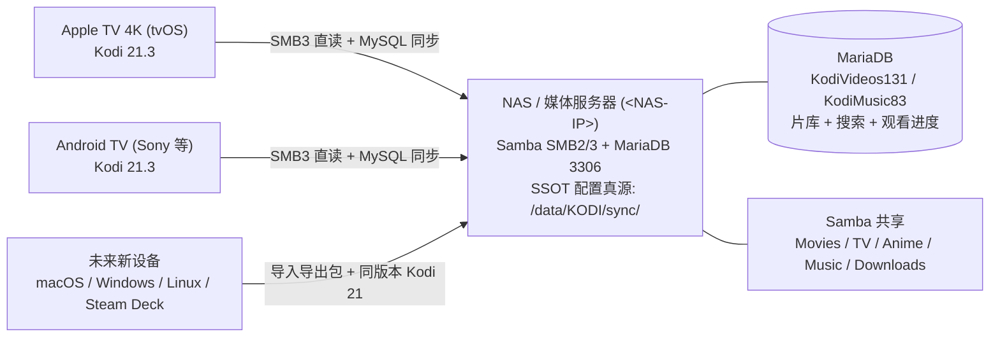

# Kodi 21 多机配置与媒体库同步方案

> [English](../en/KODI-SYNC.md) ｜ 返回 [推荐应用与配置指南](APPS.md)

本文档提供一套面向 **Kodi 21 (Omega)** 多终端（Apple TV tvOS、Android TV、macOS、Windows、Linux、Steam Deck 等）的统一配置、SMB 媒体源映射与共享数据库同步方案，同时预留未来新增设备的标准化接入流程。

---

## 1. 为什么选「SMB + 共享 MariaDB」而不是经 Plex 中转

| 维度 | Kodi 插件接 Plex（如 `script.plex` / PM4K / PKC） | Kodi 原生直连 SMB + 共享 MariaDB（推荐） |
|---|---|---|
| **解码与原盘能力** | Plex 不支持 BDMV 蓝光原盘直放；复杂 ASS 动画特效字幕易触发服务器转码 | Apple TV VideoToolbox / Android TV MediaCodec 全程原生直解 4K HDR/DoVi、BDMV 原盘与 ASS 字幕 |
| **本地 NFO / 刮削复用** | 依赖 Plex 服务端独立刮削，与 tinyMediaManager 本地 NFO 体系割裂 | Kodi 原生优先读取本地 `.nfo` 与本地海报/同人画，缺省再自动回退 TMDB 中文刮削 |
| **多机同步与搜索** | 需每台设备绑定 Plex 账号/Token，PKC 会覆写本地库 | 所有 Kodi 共用一份 MariaDB `KodiVideos131` / `KodiMusic83`，片库、全局搜索、已看标记与断点续播实时跨端同步 |
| **维护成本** | 第三方插件易随 Kodi 大版本失效（官方 `script.plex 0.3.5` 已停更） | 纯 Kodi 原生协议与配置，不依赖任何第三方插件 |

---

## 2. 多机同步架构



### 同步边界：共享什么 vs 本地保留什么

| 项目 | 是否多机共享 | 原因说明 |
|---|---|---|
| `sources.xml` / `mediasources.xml` | ✅ 共享（字节级一致） | 保证所有设备写入 MariaDB 的 `smb://<NAS-IP>/<Share>/` 路径完全一致，否则会重复入库 |
| `passwords.xml` | ✅ 共享（本地凭据渲染） | 将账号密码与路径解耦，避免明文密码落入 `sources.xml` 或 MariaDB `path` 表 |
| `advancedsettings.xml` | ✅ 共享（字节级一致） | 统一指向 MariaDB、开启观看状态/断点导入与特效/特典目录排除正则 |
| MariaDB `KodiVideos131` / `KodiMusic83` | ✅ 实时共享 | 片库元数据、中文全局搜索索引、已看标记与断点续播跨端实时一致 |
| `Thumbnails/` 与 `Textures13.db` | ❌ **各设备本地独立缓存** | 官方不推荐通过 `pathsubstitution` 跨网共享缩略图，易导致数据库锁竞争与界面卡顿 |
| `guisettings.xml` | ⚠️ 仅同步关键键，保留设备私有项 | 音视频直通/帧率/分辨率/硬件解码因平台而异，仅统一同步 SMB 协议版本、缓存、语言与 Web RPC |

---

## 3. 核心配置文件规范（模板）

> 敏感凭据应单独存放在 NAS 本机 `chmod 600` 的 `secrets.env` 中，由脚本渲染生成，**切勿提交到公开 Git 仓库**。

### 3.1 `sources.xml`
统一使用 `smb://<NAS-IP>/<Share>/`（不含用户名密码，且末尾保留 `/`）：
- 视频源：`Movie`、`TV`、`Amine`、`Downloads`
- 音乐源：`Music`

### 3.2 `passwords.xml`
按服务器前缀统一映射，无需为每个子共享重复配置：
```xml
<passwords>
    <path>
        <from pathversion="1">smb://&lt;NAS-IP&gt;/</from>
        <to pathversion="1">smb://&lt;SMB-USER&gt;:&lt;URL-ENCODED-SMB-PASS&gt;@&lt;NAS-IP&gt;/</to>
    </path>
</passwords>
```

### 3.3 `advancedsettings.xml`
- 严禁在 XML 中使用非标准 `//` 注释（仅使用 `<!-- ... -->`）；
- Kodi 21 已废弃旧版 `<cache>` 节点，缓存配置改由 `guisettings.xml` 的 `filecache.*` 控制；
- 推荐启用 `<cleanonupdate>false</cleanonupdate>`，避免 NAS 离线时误清空片库；
- 推荐配置 `<excludefromscan action="append">` / `<excludetvshowsfromscan action="append">`（保留 Kodi 内置 `trailer`/`sample` 规则并追加排除 `Downloads/`、`SPs/`、`PV/`、`Extra/`、`Bonus/`、`Menu/`、`CD/`、`特典`、`纪录片/` 等目录）；若音乐目录仅浏览不刮削，可同时配置 `<audio><excludefromscan action="append"><regexp>Music\/</regexp></excludefromscan></audio>`。

### 3.4 `guisettings.xml` 推荐统一项（保留设备原生音画设置）
- `locale.language` = `resource.language.zh_cn`
- `smb.minprotocol` = `2`、`smb.maxprotocol` = `3`、`smb.chunksize` = `128`（兼容关闭 SMBv1 的现代 Samba）
- `filecache.buffermode` = `1`（缓冲全部网络共享）、`filecache.memorysize` = `64`（64 MB，流畅播 4K 原盘）、`filecache.readfactor` = `400`
- `videolibrary.updateonstartup` = `true`（启动自动增量入库，保持搜索结果最新）
- `musiclibrary.updateonstartup` = `false`、`musiclibrary.backgroundupdate` = `false`、`musiclibrary.downloadinfo` = `false`（关闭音乐库自动刮削）
- `services.webserver` = `true`（端口 `8080`）、`services.esallinterfaces` = `true`（端口 `9090`，便于局域网 JSON-RPC 与 Home Assistant 集成）

---

## 4. 各平台 `userdata/` 路径与未来设备接入指南

> **版本约束**：所有共享同一 MariaDB 库的终端必须运行**同一 Kodi 主版本**（如全部为 **Kodi 21.x Omega**，对应 `Videos131` / `Music83`），避免小跨大版本引发 schema 升级分叉。

| 平台 / 设备 | Kodi `userdata/` 路径 | 推荐同步方式 |
|---|---|---|
| **Apple TV 4K（tvOS + Relaxin/roothide）** | `/var/mobile/Library/Caches/Kodi/userdata/` | SSH/SCP 推送 4 个 XML + `patch-gui` 修补 `guisettings.xml`（注意推送前先结束旧后台 Kodi 进程，防止退出时回写旧 `guisettings.xml`） |
| **Android TV（Sony / Shield 等）** | `/sdcard/Android/data/org.xbmc.kodi/files/.kodi/userdata/` | 局域网 ADB 静默推送（不唤醒屏幕、不切信号源） |
| **macOS（预留）** | `~/Library/Application Support/Kodi/userdata/` | 从 NAS 导出包直接拷贝 4 个 XML + `patch-gui` |
| **Windows（预留）** | `%APPDATA%\Kodi\userdata\` | 从 NAS 导出包直接拷贝 4 个 XML + `patch-gui` |
| **Linux / Steam Deck（预留）** | `~/.kodi/userdata/`（Flatpak：`~/.var/app/tv.kodi.Kodi/data/userdata/`） | 从 NAS 导出包直接拷贝 4 个 XML + `patch-gui` |
| **iPadOS / iOS（预留）** | `<App-Container>/Library/Preferences/Kodi/userdata/` | SSH/文件共享导入导出包 |

### 新增一台设备的标准 4 步接入流程
1. 安装同主版本 **Kodi 21.x (Omega)**，先运行一次让 Kodi 初始化默认 `userdata/`，然后完全退出；
2. 在 NAS 执行 `python3 /data/KODI/sync/sync_kodi.py render --out <导出目录>` 生成 4 个已校验 XML；
3. 将 `sources.xml`、`mediasources.xml`、`passwords.xml`、`advancedsettings.xml` 拷入新设备 `userdata/`（并运行 `patch-gui` 对齐 SMB2/3 与缓存参数）；
4. 启动 Kodi，无需重新刮削、无需手动「设置内容」，片库、搜索、已看状态与续播进度立即可用。

---

## 5. 首次扫库与搜索验证清单

1. **SMB 与数据库连通性**：在 NAS 确认 `smbclient //<NAS-IP>/<Share> -m SMB3` 正常列出目录，MariaDB 中 `KodiVideos131.path` 已预置 `Movie`（电影）/ `TV`（剧集）/ `Amine`（剧集）刮削器（TMDB `zh-CN` + 本地 NFO 优先），非刮削目录（如 `Downloads/`）显式标记 `noUpdate=1, exclude=1`；
   > **Kodi 21 (Videos131) 建库坑点**：若用 `mysqldump --no-data` 克隆空库而非由 Kodi 自行初始化，务必同步灌入内置种子表 `version`（`idVersion=131`）与 **`videoversiontype`**（387 行版本类型定义）；否则 `movie_view` 的 `INNER JOIN videoversiontype` 会返回 0 行，导致电影明明入库却在 UI 与 JSON-RPC 中不可见。
2. **首次入库**：在任意一台已配置设备上打开 Kodi 21，自动触发（或通过 JSON-RPC `VideoLibrary.Scan` 触发）一次扫描；
3. **搜索与多机同步验收**：
   - 在设备 A 打开「电影 / 剧集 → 搜索」，输入中英文片名确认秒出结果并能直接 4K 播放；
   - 在设备 A 播放某片 2 分钟后停止；
   - 打开设备 B 的 Kodi，确认无需重新刮削即可看到同一片库、相同搜索结果与刚刚的断点续播进度。
