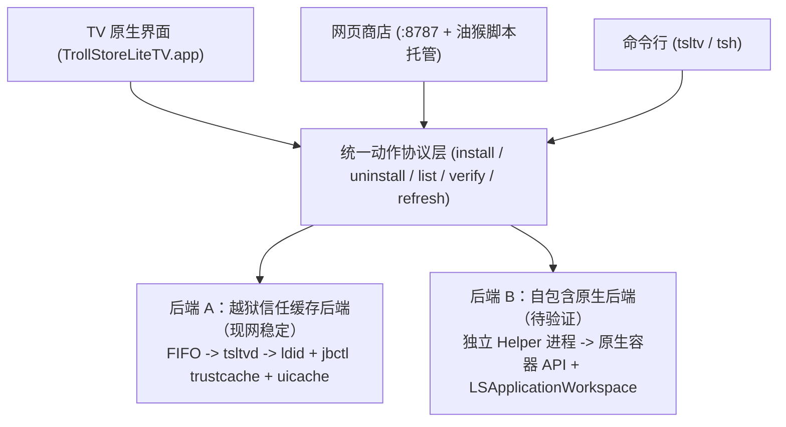
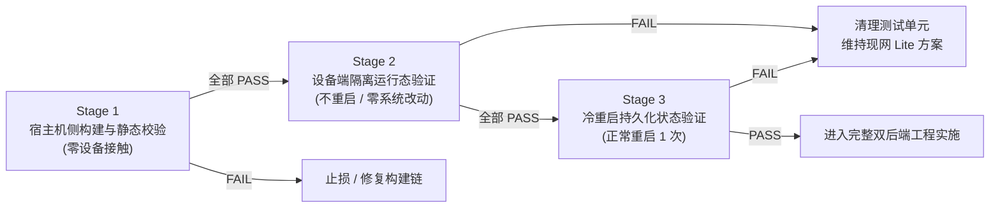

[中文](VERIFICATION-DESIGN.md) · [English](../en/VERIFICATION-DESIGN.md)

# 三级最小验证系统设计文档（架构与风险控制规范）

> 适用项目：TrollStore Lite TV（`tvOS 17.x`）架构演进研究  
> 文档性质：**系统验证框架、隔离边界与双后端架构设计**（纯架构与验收方法论，不含任何漏洞利用代码或具体攻击指令）

---

## 1. 设计目标与核心原则

在不可降级且无 USB 恢复口的 Apple TV 4K（`AppleTV14,1`，tvOS 17.0 `21J354`）上评估新的应用签名/注册后端机制时，首要目标不是“尽快跑通”，而是**确保任何失败都可 100% 无损回滚，绝不影响现有稳定环境**。

本设计遵循四条硬原则：

1. **隔离优先（Blast-Radius Isolation）**：测试对象必须使用完全独立的测试标识（如 `com.tsltv.verify.poc`）与独立目录，与生产应用（`TrollStoreLiteTV`、`Kodi`、`YouTubeTVL`、`Browser`、`RelaxinTV`）物理隔离。
2. **只增不改（Zero System Mutation）**：绝不修改 `/rootfs` 只读卷、绝不替换或寄生系统内置 App、绝不改动越狱 basebin 或系统级 LaunchDaemon。
3. **负证明优先（Falsification First）**：在投入完整工程开发前，用最小测试单元先验证核心假设是否成立；一旦证伪，立即止损，避免沉没成本。
4. **可观测验收（Evidence-Based Gating）**：每一级验证必须由客观可观测信号（进程退出码、系统状态查询、进程列表、截屏画面）判定通过/失败，禁止凭主观推断进入下一级。

---

## 2. 系统分层与双后端抽象架构

为了避免在验证不同底层机制时反复重写前端，将系统拆分为**稳定的展示与控制层**和**可插拔的执行后端**：



### 接口契约（后端无关）

无论采用哪个后端，对外只暴露同一组幂等/受护栏保护的操作语义：

| 操作 | 输入 | 成功判据 | 安全护栏 |
|---|---|---|---|
| `preflight(ipa)` | 本地 `.ipa` | 解析 `platform` / `minOS` / `cryptid` | `cryptid != 0` 强制拒绝 |
| `install(ipa)` | 未加密 `.ipa` | 部署容器 + 签名/信任 + 注册 + 记账 | 仅写独立应用目录与记账文件 |
| `verify(bid)` | `bundle_id` | 签名状态、注册类型、主二进制一致性均正常 | 只读检查，无副作用 |
| `uninstall(bid)` | `bundle_id` | 注销注册 + 删除目录 + 清理记账 | 仅允许删除 `origin=install` 条目 |

---

## 3. 安全边界与回滚机制设计

在进入三级验证前，先定义固定的隔离护栏与回滚契约：

| 护栏项 | 约束规则 | 回滚动作 |
|---|---|---|
| **命名空间隔离** | 仅允许使用专用测试 Bundle ID（`com.tsltv.verify.*`）与专用临时目录 | 删除对应独立容器与临时目录，注销该测试 Bundle ID |
| **信任缓存纯净性** | 评估非越狱态兼容能力时，测试单元**不得**写入越狱内核信任缓存，防止出现假阳性 | 校验信任缓存条目数在测试前后一致 |
| **生产环境零触碰** | 不覆盖 `/Applications` 现有应用、不修改 `installed.tsv` 中已有 7 条生产记录 | 验证前后对比 `tsltv verify` 确认 7/7 仍全部 `PASS` |
| **系统卷零写入** | 跳过 Persistence Helper 系统应用替换阶段，不碰 `/rootfs/Applications/` | 无需系统级恢复 |

---

## 4. 三级最小验证体系设计

三级验证按**风险从零到低、成本从小到大**依次递进；任一级不通过时先回退清理并排查根因，再决定下一步调整（不设重试次数硬上限，唯一硬边界为保护设备不崩、不未经确认重启）。



### Stage 1：宿主机侧构建与静态元数据校验（零设备风险）

- **验证目标**：确认在不接触 Apple TV 的前提下，编译工具链、最小测试载荷与静态结构全部符合 tvOS 17.0 目标规范。
- **验证对象**：
  1. 极简命令行测试单元（仅输出进程 `uid`/`pid` 并正常退出 `0`，零文件写入）；
  2. 极简 UIKit 测试 App（单页面显示纯色背景与文本标识，验证 FrontBoard 可正常渲染）。
- **静态检查清单**：
  - 架构与平台：`arm64`、`platform = 3 (tvOS)`、`minOS <= 17.0`、`cryptid = 0`；
  - Bundle 结构：`Info.plist` 中 `CFBundleIdentifier`（`com.tsltv.verify.*`）、`CFBundleExecutable`、`CFBundlePrimaryIcon` 完整一致；
  - 权限声明：确认测试单元仅包含最小必需权限集合，不含越界路径写入权限。
- **通过判据**：全部静态元数据检查通过且本地自动化测试 0 失败。

### Stage 2：设备端隔离运行态验证（不重启、不改系统应用）

- **验证目标**：在不重启设备、不修改任何现有应用与系统文件的前提下，验证最小测试单元在目标运行时环境下的加载、容器部署、注册类型与进程拉起链路。
- **分项验收矩阵**：

| 子项 | 验证内容 | 预期可观测证据 | 失败判定 |
|---|---|---|---|
| **2A. 独立运行校验** | 测试单元在不写入越狱信任缓存的前提下启动 | 正常执行并返回退出码 `0` | 内核终止（如 `SIGKILL` / `Killed: 9`） |
| **2B. 原生容器与注册** | 使用 tvOS 运行时容器与 LaunchServices API 完成独立容器部署与 `System` 类型注册 | 查询返回已注册且 `Type = System`，路径位于独立测试容器 | 注册报错或回落为不可启动状态 |
| **2C. 界面拉起与画面确认** | 请求系统拉起测试 App 并采集实时画面 | 进程稳定驻留、无崩溃转储、截屏可见测试标识文本 | 闪退、黑屏或产生 `.ips`/`.dmp` 崩溃日志 |
| **2D. 生产基线回归** | 测试期间及清理后复验现有环境 | `tsltv verify` 7/7 `PASS`，Kodi / YouTube TVL / Browser 不受影响 | 任一现有应用状态退化 |

- **清理动作**：完成数据采集后，若未准备进入 Stage 3，立即注销并删除测试单元，确认设备状态 100% 回归基线。

### Stage 3：冷重启持久化状态验证（Go / No-Go 最终闸门）

- **验证目标**：在真实断电/重启且**尚未重新激活越狱环境**的状态下，验证测试 App 的持久化可启动性与边界行为。
- **验证流程**：
  1. 确认 Stage 2 的测试 App 处于正常可启动状态，记录当前状态快照；
  2. 执行一次正常的 Apple TV 重启；
  3. **先不激活越狱**：直接从主屏启动测试 App，观察是否能正常进入界面；
  4. **边界确认**：记录该状态下已安装测试 App 的表现（明确是否依赖系统图标缓存未重建）；
  5. **恢复基线**：重新激活日常越狱环境，复验原有 7 个应用与 `:8787` 服务状态全部正常，然后清理测试 App。

---

## 5. 决策矩阵（Go / No-Go Criteria）

| 验证结果组合 | 结论 | 后续工程策略 |
|---|---|---|
| Stage 1 + 2 + 3 **全部 PASS** | **GO** | 启动双后端抽象改造：保留现有 TV UI、`:8787` 网页商店与油猴托管，新增自包含原生后端并与越狱后端共存 |
| Stage 1 PASS，Stage 2A/3 **FAIL** | **NO-GO（架构止损）** | 证实当前固件在该路径下不可行；立即终止原版方向，继续深耕 `TrollStore Lite TV`（越狱态全量 `retrust` 已覆盖重启恢复） |
| Stage 2A PASS，但 2B/2C **FAIL** | **CONDITIONAL（仅工程适配问题）** | 底层机制可行但容器/注册/权限参数有偏差；仅在隔离测试单元内修正注册与 entitlements 配置后复测 Stage 2，不进入 Stage 3 |

---

## 6. 状态追踪与留档规范

每执行完一级验证，需按统一模板记录以下证据字段（禁止只写“通过/失败”）：

- **环境基线**：设备型号、精确系统版本与 Build 号（如 `AppleTV14,1` / `tvOS 17.0 21J354`）；
- **测试对象摘要**：Bundle ID、二进制哈希、架构/平台/加密标记；
- **可观测输出**：退出码、注册类型查询结果、进程存活与资源占用、崩溃日志增量（应为 0）；
- **基线回检结果**：清理测试对象后现有生产应用的校验结果（7/7 `PASS`）。

---

## 7. 开源项目落地策略（仓库、许可证评估、互引与本地构建）

### 7.1 仓库与演进策略

- **保持 `trollstore-lite-tv` 作为稳定主线不动**：继续服务所有已越狱 tvOS 17.x 设备，保持轻量、零复杂 C 库依赖、现有 `.deb` 升级链路稳定。
- **新机制采用独立仓库演进**：将新架构（自包含原生后端 + 三级验证实现）放在独立仓库中开发；前端复用 `TrollStore Lite TV` 的 TV 界面与 `:8787` 网页商店，通过第 2 节定义的统一动作协议对接后端。
- **命名与引用原则**：
  - 文档中仅以指示性方式提及 `Apple TV`（产品名）、`tvOS`（系统名）说明运行平台；
  - 对 `TrollStore` 等开源项目重点做好**规范互引、仓库链接、版权保留与 Credit 致谢**，不在未授权情况下声称与上游官方项目存在隶属关系。

### 7.2 许可证核查与授权方案评估（实测上游 LICENSE）

已直接核对全部相关上游与外部开源项目的真实 `LICENSE` 文件：

| 项目 / 库 | 实测许可证 | 版权方 | 与本项目的关系 | 与 MIT 兼容性 |
|---|---|---|---|---|
| [`opa334/TrollStore`](https://github.com/opa334/TrollStore) | 主体 **MIT**；仅 `RootHelper/uicache.m` 为 **BSD-4-Clause**（DEP-5 格式） | Lars Fröder（`uicache.m` 含 CoolStar / Procursus） | 架构参考 / 潜在代码借鉴 | ✅ 主体兼容 MIT；若复用 `uicache.m` 需在 `NOTICE` 保留 CoolStar BSD-4-Clause 声明 |
| [`straight-tamago/TrollStore-tvOS`](https://github.com/straight-tamago/TrollStore-tvOS) | **MIT** + 保留上游 DEP-5（MIT + `uicache.m` BSD-4-Clause） | straight-tamago / Lars Fröder | tvOS 适配参考 | ✅ 同上 |
| [`opa334/ChOma`](https://github.com/opa334/ChOma) | 纯 **MIT** | Lars Fröder | Mach-O 处理库参考 | ✅ 100% 兼容 MIT |
| [`owngoal-dev/Relaxin`](https://github.com/owngoal-dev/Relaxin) | 纯 **MIT** | `@Lakr233` | 运行环境前置 / 文档引用 | ✅ 100% 兼容 MIT |
| [`Lakr233/vphone-cli`](https://github.com/Lakr233/vphone-cli) | 纯 **MIT** | Lakr233 | 可选虚拟调试参考 / 文档引用（**按当前最新版本限制**：tvOS 预设仅支持约 tvOS 26.6–27.x / tvOS 27 左右，不支持 tvOS 17.x） | ✅ 100% 兼容 MIT |
| [`majd/ipatool`](https://github.com/majd/ipatool) | 纯 **MIT** | Majd Alfhaily | 外部工具文档引用 | ✅ 100% 兼容 MIT |
| [`reisxd/TizenTubeCobalt`](https://github.com/reisxd/TizenTubeCobalt) | **BSD-3-Clause** | Reis Can | 外部脚本生态引用 | ✅ 100% 兼容 MIT |
| [`EthanArbuckle/fairplay-decrypt`](https://github.com/EthanArbuckle/fairplay-decrypt) | **GPL-3.0** | Ethan Arbuckle | **仅外部文档引用、零源码引入** | ⚠️ 若引入源码会触发 GPL 传染且与 BSD-4-Clause 冲突；保持外部引用则零冲突 |
| [`libarchive`](https://github.com/libarchive/libarchive) / [`OpenSSL 3`](https://github.com/openssl/openssl) | **BSD-2-Clause** / **Apache-2.0** | 各自社区 | 原生后端可选链接库 | ✅ 均与 MIT 兼容（保留对应 NOTICE） |

**授权策略结论**：
1. **主许可证继续采用标准纯 MIT（与 TrollStore 上游主体一致）**：
   - 根目录 `LICENSE` 保持标准纯 **MIT License**（不直接照搬 DEP-5 混合文本进 `LICENSE`，否则 GitHub 会识别为 `NOASSERTION` 而丢失 `MIT` 徽章）。
   - 所有上游与第三方归属统一写在根目录 `NOTICE` 与 `CREDITS.md` 中，逐项附上原仓库链接、版权人和许可证名称。
2. **两条硬兼容边界**：
   - **不复用 `RootHelper/uicache.m`（优先用原生 `LSApplicationWorkspace` 自写）**：整仓可保持 100% 纯 MIT；若确需复用 `uicache.m`，必须在 `NOTICE` 与文件头完整保留 CoolStar / Procursus / Lars Fröder 的 BSD-4-Clause 声明。
   - **`fairplay-decrypt`（GPL-3.0）严格保持纯外部文档引用**：绝不复制或静态打包进仓库，避免许可证传染与 BSD-4-Clause 冲突。

### 7.3 构建与验证策略（本地优先、免远端 CI）

- **不强求远端 CI**：tvOS 交叉编译依赖本机 Xcode SDK / 私有框架头文件与真机验证环境，公共 GitHub Actions Runner 维护成本高且无法覆盖真机行为。
- **采用“本地一键自检 + 本地 macOS 编译打包”模式**：
  - 仓库提供本地验证脚本（如 `./scripts/check.sh`）：负责 shell/代码语法检查、核心纯逻辑单测、plist/JSON 校验，以及防敏感文件（`.ipa` / `.bin` / `.p12` / 凭据）误提交检查；
  - 每次发版前在本机 macOS 上完成编译、本地校验与真机验收后，直接通过 `gh release create` 上传产物。

### 7.4 实现落地分层清单

| 模块 | 实现来源 | 说明 |
|---|---|---|
| **前端壳（TV UI + `:8787` 网页商店 + 油猴托管）** | 直接复用 `trollstore-lite-tv` 现有实现 | 保持 39 ms 异步缓存、XHR 上传进度条与 `/api/userscripts.js` 托管 |
| **统一动作协议层** | 新建轻量适配层 | 对上暴露 `preflight / install / uninstall / list / verify / refresh`，对下按配置路由到越狱后端或自包含原生后端 |
| **版本预检与护栏（Preflight）** | 复用并扩展 `macho_info` / `precheck_verdict` | 启动与安装前校验设备机型、tvOS Build、二进制架构与 `cryptid == 0`，不满足直接明确退出 |
| **文档与归属体系** | 标准模板 | 必备 `LICENSE`（纯 MIT）、`NOTICE`（完整上游与外部工具 Credit 列表）、`README.md` / `README.zh.md`、`SECURITY.md`、`.gitignore` |

---

## 8. Stage 1 工程落地（2026-11-25）

Stage 1 已实现为可重复执行的宿主机闸门 [`tests/stage1/run.sh`](../../tests/stage1/run.sh)：在本机 `AppleTVOS.sdk` 下构建 CLI 与 UIKit 两个最小测试单元，校验架构、平台、`minos`、`cryptid`、Bundle 结构与签名状态，并按 §6 输出证据字段；全程不接触 Apple TV。

```sh
./tests/stage1/run.sh        # 0 = 全部 PASS；2 = 本机无 tvOS SDK（跳过）
```

`tests/run.sh` 在具备 SDK 的 macOS 上自动运行该闸门，Linux CI 跳过。

---

## 9. Stage 2 隔离实测结果（2026-11-25）

> **结论：`CONDITIONAL / 暂止`。** 2B 通过，2C 未通过；不进入 Stage 3，继续以 `TrollStore Lite TV v2.1.6` 为生产主线。全程未重启、未写 `/rootfs`、未替换系统 App、未修改生产应用或 `installed.tsv`，未使用 CoreTrust / CVE-2023-41991。

### 9.1 环境基线

| 字段 | 值 |
|---|---|
| 设备 | `AppleTV14,1` |
| 系统 | `tvOS 17.0 (21J354)` |
| 实验前 uptime | 124 天（实验期间连续，未重启） |
| 实验前 trustcache | 587 / 740 |
| 生产基线 | `tsltv verify` 7/7 `PASS`；`installed.tsv` sha256 `<baseline-sha256>` |
| 测试对象 | `com.tsltv.verify.probe`；容器内主二进制与源文件哈希一致 |

### 9.2 分项结果

| 子项 | 结论 | 关键证据 |
|---|---|---|
| **2A. 独立运行校验** | `CONFOUNDED` | 仅 `application-identifier` 的 ad-hoc 未显式入缓存时被 `SIGKILL`（`rc=137`）；但 Relaxin dynamic-owner trustcache 在执行期自动写入（`587 → 592`）；特权 ad-hoc（`platform-application` / `get-task-allow`）未显式入缓存直接 `rc=0` |
| **2B. 原生容器与注册** | `PASS` | 原生 `MCMAppContainer` + `MCMAppDataContainer` + `LSApplicationWorkspace(registerApplicationDictionary:)` 完整跑通；注册为 `Type: System / Removable: true`；路径位于 `/private/var/containers/Bundle/Application/<UUID>/VerifyProbe.app` |
| **2C. 界面拉起与画面确认** | `FAIL` | 仅 `application-identifier` 与三件套 entitlements 两次 `uiopen` 均 `rc=0`；1s/5s 或 1s/7s 无进程；无 `.ips`；直接 `exec` 容器内二进制可存活；`shot` 3840×2160 正常。表现为 FrontBoard / RunningBoard 拉起契约存在缺口，根因未闭环 |
| **2D. 生产基线回归** | `PASS` | `unregister=1 deleted=1`；`query installed=0`；两个容器与 `/var/tmp/tsltv-verify-*` 全清；`tsltv verify` 7/7 `PASS`；`installed.tsv` sha256 一致；未重启；trustcache 599/740（测试 cdhash 惰性残留） |

### 9.3 2A 细节：为什么是 `CONFOUNDED`

1. 一个仅带 `application-identifier` 的普通 ad-hoc 二进制，在没有显式执行 `jbctl trustcache add` 时被内核终止，退出码 `137`（`SIGKILL`）。
2. 但同一环境下，Relaxin 的 dynamic-owner trustcache 会在执行期自动追加条目，实测从 **587 条增至 592 条**；该测试 cdhash 随后可见于缓存。
3. 带 `platform-application` 与 `get-task-allow` 的特权 ad-hoc 二进制，未显式入缓存也能以 `rc=0` 运行。

因此，在已越狱态下**不存在“纯净无 trustcache”的判据**：执行本身会改变缓存状态，特权路径又会绕过缓存检查。2A 只能记为 `CONFOUNDED`，不能据此证明或证伪信任机制。

### 9.4 2B 细节：容器与注册可行

- 助手：`tests/stage2/tsverify.m`，以 root 运行；按上游 RootHelper 的 storage / container-manager / uninstall entitlements 完成 ad-hoc 签名；助手自身未写入 trustcache。
- 部署：`MCMAppContainer` 创建应用容器，`MCMAppDataContainer` 创建数据容器；把测试 `.app` 复制进应用容器并设置可执行位。
- 注册：`LSApplicationWorkspace` 的 `registerApplicationDictionary:` 返回成功；`uicache -i` 与 `LSApplicationProxy` 查询均返回 `Type: System`、`Removable: true`，路径与容器一致。
- 容器内主二进制 sha256 与源文件一致；未触碰 `/Applications`、`installed.tsv` 或任何生产应用。

### 9.5 2C 细节：拉起静默失败

- **第一轮（仅 `application-identifier`）**：`uiopen --bundleid com.tsltv.verify.probe` 返回 `0`，但 1s / 5s 后均无进程，无新增 `.ips`；直接 `exec` 容器内二进制可存活。
- **第二轮（三件套）**：重新签名后 cdhash `098ed4699fa9fb0133b9c7dae1dbb6b20509d9e2`，trustcache 命中 1 次，条目 599/740；重新部署后 `uiopen` 仍返回 `0`，1s / 7s 后无进程，无新增 `.ips`。
- **截屏链路**：`shot` 返回 `0`，`TVOut 3840x2160`，`nonBlackSamples=3956`；但该 PNG 在 2D 清理时按测试产物删除，**未保留图片文件**，只保留 stdout 证据。
- **结论边界**：二进制、容器与注册均正常；缺口在 FrontBoard / RunningBoard 的拉起契约。本轮试验在完成两次对照后主动暂止并清理回基线，离线差异清单留待后续补充。

### 9.6 2D 细节：回归与残留

- `killall VerifyProbe`：无进程。
- `tsverify cleanup`：`unregister=1 deleted=1`；`tsverify query`：`installed=0 type=(nil) path=(nil)`。
- 应用容器与数据容器均已删除；`/var/tmp/tsltv-verify-*` 已删除；`uicache -l` 无 `tsltv.verify` 注册。
- `tsltv verify`：7/7 `PASS`；`installed.tsv` sha256 `<baseline-sha256>`，与实验前一致。
- uptime 124 天 10:53，未重启。
- trustcache 599/740：测试 cdhash 为惰性残留，对应文件已删除，不可再执行；重启后自然清空。

### 9.7 判决与证据边界

- 2A `CONFOUNDED`、2B `PASS`、2C `FAIL`、2D `PASS` → **`CONDITIONAL / 暂止`**，不进入 Stage 3。
- 2B 证明“原生容器 + LS System 注册”在当前环境可行；2C 证明“注册成功 ≠ FrontBoard 愿意拉起”，完整原生后端链路尚未闭环。
- 已知证据缺口：截屏 PNG 未保留；容器/`.app` 的 POSIX 属主未采集；`uicache -p` 的内部注册字段不在本仓库。任何补测（包括单次只读日志采集）都必须重新申报并取得授权。
- 生产策略不变：继续使用 `TrollStore Lite TV v2.1.6` 的越狱信任缓存后端；Stage 3 冷重启不在本实验范围内。
